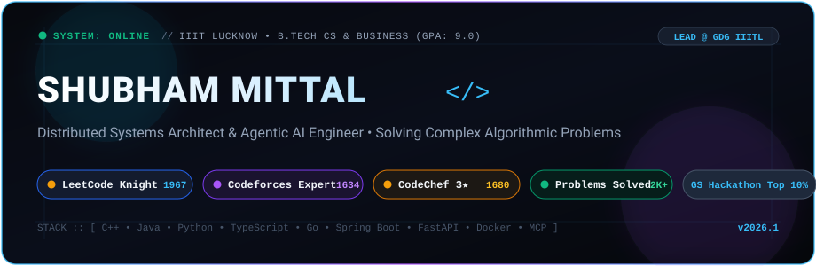
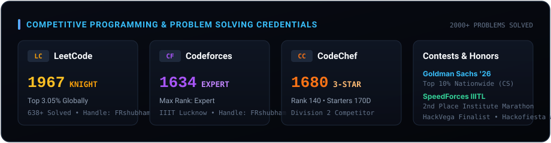

<div align="center">
  
</div>

<br/>

<div align="center">
  <a href="https://github.com/DenverCoder1/readme-typing-svg">
    
  </a>
</div>

<br/>

<div align="center">
  <a href="https://shubham-mittal.vercel.app/" target="_blank">
    
  </a>
  <a href="https://www.linkedin.com/in/shubham-mittal-6a8431322/" target="_blank">
    
  </a>
  <a href="https://leetcode.com/u/FRshubham/" target="_blank">
    
  </a>
  <a href="https://codeforces.com/profile/FRshubham" target="_blank">
    
  </a>
  <a href="mailto:shubhammittal0610@proton.me">
    
  </a>
</div>

<br/>

<p align="center">
  
</p>

## ⚡ Executive Summary

I am a **Backend & Distributed Systems Engineer**, **Competitive Programmer**, and **Agentic AI Developer** pursuing a Bachelor of Technology in Computer Science and Business at the **Indian Institute of Information Technology (IIIT), Lucknow** (*GPA: 9.0*).

My technical work converges at the intersection of **high-throughput distributed computing**, **rigorous algorithmic optimization**, and **deterministic agentic AI architectures**:
- **Distributed & Systems Engineering**: Architecting asynchronous message ingestion pipelines, cache coherency strategies, database partitioning/sharding, and resilient microservices.
- **Agentic AI & Developer Tooling**: Engineering autonomous multi-agent state machines, custom Model Context Protocol (MCP) servers, and cryptographic SHA-256 audit trails that enforce safety guardrails overriding raw LLM outputs.
- **Algorithmic Pedigree**: Solved **2,000+ programming problems** across platforms, achieving **LeetCode Knight** (Max: 1967, Top 3.05%), **Codeforces Expert** (Max: 1634), and national hackathon honors.
- **Engineering Leadership**: Serving as the **Overall Lead of Google Developer Groups (GDG) IIIT Lucknow** and **Coordinator of the Axios Competitive Programming Wing**.

<br/>

<p align="center">
  
</p>

## 🎯 Competitive Programming & Algorithmic Milestones

<div align="center">
  
</div>

<br/>

| Platform / Contest | Metric / Honor | Details & Context |
| :--- | :--- | :--- |
| **LeetCode** | **Knight (1967 Max Rating)** | Ranked in **Top 3.05%** worldwide • **638+** curated algorithm solutions |
| **Codeforces** | **Expert (1634 Max Rating)** | Peak Division 2 competitor • Handle: [`FRshubham`](https://codeforces.com/profile/FRshubham) |
| **CodeChef** | **3-Star (1680 Max Rating)** | Global **Rank 140** in Starters 170D • Active Div 2 contestant |
| **Problem Solving** | **2,000+ Problems** | Extensive mastery in Graphs, Dynamic Programming, Trees, and Number Theory |
| **Goldman Sachs India Hackathon 2026** | **Top 10% Nationwide** | Secured Top 10% rank nationwide in the premier CS Track |
| **HackVega 2.0** | **Finalist** | National-level algorithmic hackathon finalist |
| **SpeedForces (IIIT Lucknow)** | **2nd Position** | Institute-level competitive coding marathon runner-up |
| **Hackofiesta 6.1** | **Best Idea Winner** | Flagship annual hackathon winner for distributed architecture |

<br/>

<p align="center">
  
</p>

## 🛠️ Technical Arsenal

<div align="center">

### Core Programming Languages


### Distributed Systems & Backend Architecture


### Databases & Persistence


### Agentic AI & Developer Tooling


### Cloud, Infrastructure & DevOps


</div>

<br/>

<p align="center">
  
</p>

## 🚀 Featured Engineering Projects

<table>
  <tr>
    <td width="50%" valign="top">
      <h3>🛡️ RecoveryPilot — Razorpay AI Buildathon 2026</h3>
      <p><b>Agentic Payment Failure Recovery Pipeline with Cryptographic Audit Trails</b></p>
      <ul>
        <li>Architected a <b>5-state autonomous recovery machine</b> diagnosing failed Razorpay transactions via an LLM reasoning over real historical evidence tables and ML advisory scores.</li>
        <li>Executes bounded recovery actions through the live Razorpay Orders API (test mode) with <i>zero fabricated confidence scores</i>.</li>
        <li>Enforced <b>deterministic safety guardrails</b> in code (max-attempt caps, manual-review thresholds) overriding LLM hallucination risks.</li>
        <li>Implemented a <b>SHA-256 hash-chained immutable audit trail</b> with a verification endpoint cryptographically proving zero record tampering.</li>
        <li>Engineered a leakage-free dual-dataset pipeline (2,000 historical + 300 live records) training a logistic regression model, achieving a <b>53% measured recovery rate</b> on live batches.</li>
      </ul>
      <p>
        <code>Python</code> • <code>FastAPI</code> • <code>Next.js</code> • <code>Groq LLaMA-3</code> • <code>scikit-learn</code> • <code>Razorpay API</code>
      </p>
      <p>
        <a href="https://github.com/shubham-x06/RecoveryPilot"><b>📦 View Repository</b></a> • 
        <a href="https://recovery-pilot-six.vercel.app"><b>🌐 Live Application</b></a>
      </p>
    </td>
    <td width="50%" valign="top">
      <h3>⚡ LeetCode AI: Socratic Interview Simulator</h3>
      <p><b>Full-Stack Chrome MV3 Extension &amp; Timed Assessment Engine</b></p>
      <ul>
        <li>Developed a full-stack Chrome extension (<b>Manifest V3</b>) with a real-time web dashboard.</li>
        <li>Engineered a custom <b>cookie-bridge authentication system</b> enabling seamless cross-domain session synchronization between browser tabs and the web client.</li>
        <li>Built an <b>AI Interview Simulator</b> orchestrating 60-minute timed assessments, integrating the LeetCode GraphQL API with <b>parallelized fetching via Promise.all</b> to slash latency by <b>40%</b>.</li>
        <li>Optimized reliability via a <b>sliding-window context manager</b> and a hyper-strict JSON parser with recursive fallbacks, eliminating LLM prompt drift and preventing UI crashes.</li>
      </ul>
      <p>
        <code>TypeScript</code> • <code>React</code> • <code>Node.js</code> • <code>Express</code> • <code>MongoDB</code> • <code>Groq</code> • <code>Chrome MV3</code>
      </p>
      <p>
        <a href="https://github.com/shubham-x06/leetcode_ai_extension"><b>📦 View Repository</b></a> • 
        <a href="https://leetcode-ai-extension-gold.vercel.app"><b>🌐 Live Application</b></a>
      </p>
    </td>
  </tr>
  <tr>
    <td width="50%" valign="top">
      <h3>📦 AI-Powered Logging Ecosystem</h3>
      <p><b>High-Throughput Asynchronous Distributed Logging Engine with Autonomous Root-Cause Debugger</b></p>
      <ul>
        <li>Architected a high-throughput, thread-safe asynchronous logging engine leveraging the <b>Producer-Consumer pattern</b> and <b>BlockingQueue</b>, ensuring zero-loss log ingestion across distributed microservices.</li>
        <li>Engineered a real-time AI debugging pipeline utilizing <b>Java WatchService</b> and Groq LLaMA-3, reducing debugging Mean Time to Resolution (MTTR) by <b>60%</b> through automated root-cause analysis and streaming remediations.</li>
        <li>Published a production-ready client library to <b>NPM (<a href="https://www.npmjs.com/package/@shubhammittal/custom-logger-client"><code>@shubhammittal/custom-logger-client</code></a>)</b>.</li>
        <li>Containerized the entire stack with <b>Docker Compose</b> for localized centralized log aggregation.</li>
      </ul>
      <p>
        <code>Java</code> • <code>Spring Boot</code> • <code>Groq LLaMA-3</code> • <code>Docker Compose</code> • <code>Picocli</code> • <code>NPM</code>
      </p>
      <p>
        <a href="https://github.com/shubham-x06/custom-logger"><b>📦 View Repository</b></a> • 
        <a href="https://custom-logger.onrender.com"><b>🌐 Live Application</b></a> • 
        <a href="https://www.npmjs.com/package/@shubhammittal/custom-logger-client"><b>📦 NPM Package</b></a>
      </p>
    </td>
    <td width="50%" valign="top">
      <h3>🔍 Business Entity Resolution Engine</h3>
      <p><b>High-Dimensional Machine Learning Pipeline for Enterprise Record Deduplication</b></p>
      <ul>
        <li>Built an entity resolution and disambiguation engine processing heterogeneous business enterprise datasets.</li>
        <li>Implemented multi-pass blocking heuristics and probabilistic record linkage algorithms (Levenshtein, Jaro-Winkler) to scale pairwise comparisons.</li>
        <li>Trained supervised classification models to evaluate match confidence scores with calibrated precision-recall thresholds.</li>
        <li>Containerized data processing workflows with reproducible environment configurations.</li>
      </ul>
      <p>
        <code>Python</code> • <code>scikit-learn</code> • <code>Pandas</code> • <code>Record Linkage</code> • <code>Docker</code>
      </p>
      <p>
        <a href="https://github.com/shubham-x06/business-entity-resolution"><b>📦 View Repository</b></a>
      </p>
    </td>
  </tr>
</table>

<br/>

<p align="center">
  
</p>

## 📊 GitHub Analytics & Repository Metrics

<div align="center">
  <table>
    <tr>
      <td align="center">
        
      </td>
      <td align="center">
        
      </td>
    </tr>
  </table>
  <br/>
  
</div>

<br/>

<p align="center">
  
</p>

## 🐍 Contribution Activity & Snake Animation

<div align="center">
  <picture>
    <source media="(prefers-color-scheme: dark)" srcset="https://raw.githubusercontent.com/shubham-x06/shubham-x06/output/github-contribution-grid-snake-dark.svg">
    <source media="(prefers-color-scheme: light)" srcset="https://raw.githubusercontent.com/shubham-x06/shubham-x06/output/github-contribution-grid-snake.svg">
    
  </picture>
</div>

<br/>

<p align="center">
  
</p>

## 💼 Leadership & Community Engagements

- **Overall Lead — Google Developer Groups (GDG), IIIT Lucknow** *(June 2026 – Present)*  
  Directing developer initiatives, orchestrating large-scale hackathons, technical conferences, and hands-on workshops on Agentic AI, Cloud Architecture, and Distributed Systems for the engineering student community.
  
- **Coordinator, Competitive Programming Wing — Axios, IIIT Lucknow** *(Oct 2025 – Present)*  
  Mentoring collegiate programmers in algorithmic problem solving, leading weekly contest debriefs, and curating competitive programming problemsets for campus and national contests.

<br/>

<p align="center">
  
</p>

## 📬 Connect & Collaborate

<div align="center">

```
  ┌────────────────────────────────────────────────────────────────────────┐
  │                                                                        │
  │   💬 Open for: Distributed Systems, High-Performance Backends,        │
  │                Agentic AI & Engineering Leadership Opportunities       │
  │                                                                        │
  │   🌐 Portfolio:  https://shubham-mittal.vercel.app/                    │
  │   💼 LinkedIn:   https://www.linkedin.com/in/shubham-mittal-6a8431322/ │
  │   📧 Email:      shubhammittal0610@proton.me                           │
  │   ⚡ LeetCode:   https://leetcode.com/u/FRshubham/                     │
  │   🏆 Codeforces: https://codeforces.com/profile/FRshubham              │
  │                                                                        │
  └────────────────────────────────────────────────────────────────────────┘
```

</div>

<br/>

<div align="center">
  <sub>Designed &amp; Engineered with precision by <b>Shubham Mittal</b> • <i>"Simplicity is prerequisite for reliability."</i></sub>
</div>
